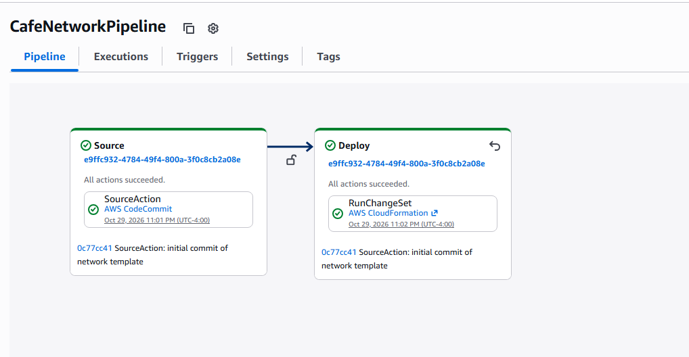
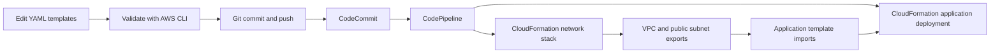

# AWS Automating Infrastructure Deployment

**Tyree Payne · Cloud infrastructure lab · October 2026**

A hands-on lab using AWS CloudFormation, Git, CodeCommit, and CodePipeline to move infrastructure changes from YAML templates into deployed AWS resources. The work covered an S3 static website, a reusable network stack, and a separate café application template.

## Highlights

- Created and updated an S3 bucket through CloudFormation, uploaded website assets, and verified the café static website in a browser.
- Committed a network template to CodeCommit and observed a successful CodePipeline deployment.
- Exported the VPC and public subnet IDs for reuse by the application stack.
- Validated an EC2 application template and investigated the relationship between its AMI and bootstrap commands.

## Deployment flow

This diagram summarizes the lab workflow. The network pipeline is directly shown in the evidence; application pipeline success was reported in my lab troubleshooting conversation.

## Skills practiced

**Infrastructure as code:** YAML, CloudFormation resources, parameters, outputs, cross-stack references.  
**Delivery workflow:** Git, CodeCommit, CodePipeline, AWS CLI template validation.  
**AWS infrastructure:** S3 website hosting, VPC, subnets, routing, security groups, EC2, Systems Manager AMI parameters.

## Results and boundaries

| Milestone | Evidence |
|---|---|
| S3 static website displayed | Original lab screenshot reviewed during preparation of this case study |
| Network pipeline source and deploy stages succeeded | [Pipeline screenshot](evidence/network-pipeline-success.png) |
| VPC and subnet export definitions | [Network outputs](evidence/network-exports.png); original console screenshot also showed UPDATE_COMPLETE and exported IDs |
| Application template passed `validate-template` | [Template and CLI output](evidence/application-template-validation.png) |
| Application pipeline succeeded | Reported in the lab chat; no matching pipeline screenshot supplied |
| Dynamic EC2 café website functioned end to end | Not verified in the supplied evidence |

The application template screenshot uses an Amazon Linux 2 AMI parameter. The lab chat identified that the bootstrap commands expected Amazon Linux 2023. A corrected deployment and final application health check are not documented here. Pipeline success and template validation alone do not prove application health.

[Read the case study](docs/case-study.md) · [Evidence guide](docs/evidence.md)

## Repository scope

This is a portfolio case study based on my lab screenshots and troubleshooting notes. The original complete YAML source files were not included in the supplied materials, so this repository does not present reconstructed templates as tested source or claim to be a turnkey deployment. No AWS resources are created by this repository.

The café application and lab environment were supplied by the training exercise; my work focused on infrastructure configuration, deployment, validation, and troubleshooting.
