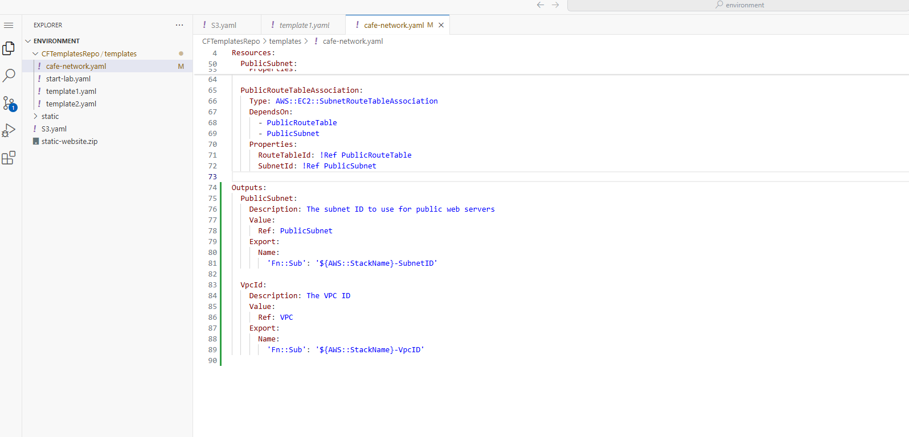
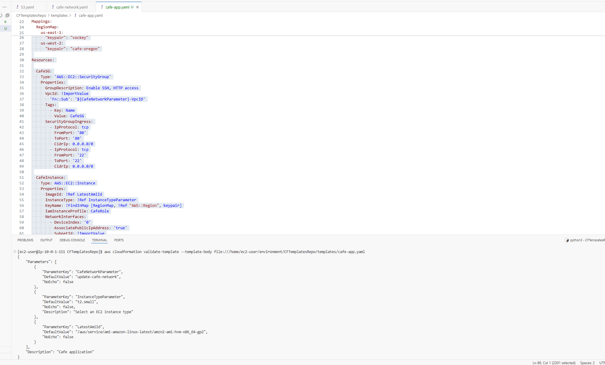

# Case study: automating infrastructure deployment

## Goal

Use version-controlled infrastructure templates to provision a café lab environment and understand how a source change becomes a deployed AWS resource.

## 1. Start with S3 and CloudFormation

I defined an S3 bucket in a YAML template and submitted it using the AWS CLI. An early command failed because the requested filename did not match the file on disk; correcting the filename allowed stack creation to proceed. This reinforced the need to check paths and case before diagnosing a cloud service failure.

I then added website configuration, an index document, a retained-resource deletion policy, and a website URL output. After uploading the supplied website assets and updating the stack, the evidence shows UPDATE_COMPLETE and the static café page displayed in a browser.

The lab used public-read website objects. That was part of the exercise, not a claim that the configuration is a production security baseline. Retaining a bucket also means stack deletion does not perform complete storage cleanup.

## 2. Deliver the network through Git and a pipeline

I cloned CFTemplatesRepo from CodeCommit, added cafe-network.yaml, committed the template, and pushed it. The network template defined a VPC, internet gateway, routing resources, and a public subnet. CafeNetworkPipeline then showed successful Source and Deploy stages, with the deploy action using CloudFormation.

The original console evidence shows the café VPC, its public subnet, and a completed network stack. This connects the Git change to actual infrastructure rather than stopping at a successful push.

## 3. Publish a contract between stacks

I added outputs exporting the public subnet and VPC IDs under names derived from the stack name. The application template uses ImportValue with the network-stack parameter to resolve these resources.

Separating network and application templates made the dependency explicit. It also made naming consistency important: the application's import names must match the network's exports.

## 4. Validate the application template and investigate compatibility

The application template includes an EC2 instance, security group, instance-type parameter, regional key-pair mapping, instance profile reference, and imports from the network stack. The supplied screenshot shows a successful AWS CLI validate-template response.

My lab chat records that the application pipeline subsequently succeeded. It also identifies an unresolved mismatch: the template used the Amazon Linux 2 AMI parameter while the bootstrap instructions expected Amazon Linux 2023. The supplied evidence does not establish that the dynamic café application loaded successfully or that the AMI correction was deployed.

## What I learned

- A local filename error can block a deployment before AWS evaluates the template.
- A successful Git push is only one checkpoint; pipeline stages and CloudFormation status provide additional evidence.
- Outputs and imports let separate stacks share infrastructure without hard-coding resource IDs.
- Template validation, infrastructure deployment, and application health are separate checks.
- The operating system selected by an AMI must agree with the application's installation commands.

## Next improvements

These are proposed follow-up work, not completed lab outcomes:

1. Align the AMI and bootstrap script, redeploy, inspect initialization logs, and verify the dynamic café endpoint.
2. Restrict administrative access: the pictured lab security group allows SSH from 0.0.0.0/0.
3. Add automated template checks and a review step before deployment.
4. Test change-set review, rollback behavior, and cleanup of retained resources in a disposable environment.

## Scope

This was a training lab. It does not demonstrate production availability, zero-downtime changes, cost savings, multi-region recovery, or a completed security hardening exercise. No such outcomes are claimed.
